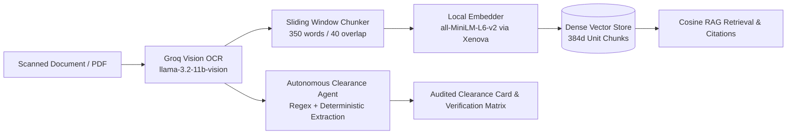

# DocDigitize

> **Local Vector RAG & Autonomous Academic Clearance Audit Engine**  
> Accepted at **ICMLDE 2026** (International Conference on Machine Learning and Data Engineering).

[](https://docdigitize.vercel.app)
[](https://nextjs.org/)
[-blue?style=flat-square)](https://huggingface.co/sentence-transformers/all-MiniLM-L6-v2)
[](https://groq.com/)
[](LICENSE)

---

## Overview

DocDigitize is an enterprise-grade document intelligence platform designed to eliminate manual paper processing, lost student records, and departmental clearance backlogs in higher institutions.

Combining **high-speed multimodal OCR (Groq Vision)**, **client/server on-device dense vector embeddings (`all-MiniLM-L6-v2`)**, and an **Autonomous Compliance Auditor**, DocDigitize converts unsearchable scans into verified, semantically searchable knowledge bases in under 12 seconds per document.

---

## System Architecture



### Key Technical Innovations

1. **Zero-API-Cost Vector Retrieval (Local RAG)**
   - Dense embeddings computed on-premise/in-process via `@xenova/transformers` running the quantized `all-MiniLM-L6-v2` ONNX pipeline.
   - Produces unit-normalized 384-dimensional vectors; cosine similarity simplifies to rapid dot-product operations in memory or MongoDB vector indexes.
   - Eliminates per-query embedding costs and external embedding API latency.

2. **Grounded Multi-Chunk Citations**
   - Natural language queries retrieve top-k semantically relevant chunks with similarity scores $\ge 0.15$.
   - Responses in the interactive chat interface cite exact source chunks with similarity confidence badges, preventing LLM hallucination.

3. **Autonomous Academic Clearance Audit Engine**
   - Extracts and verifies critical institutional metadata:
     - Matriculation / Student ID formatting
     - Transaction & Reference IDs (Bursary fees, department dues)
     - Timestamp & academic session validation
     - Physical seal / registrar signature verification
   - Provides clear compliance status: `VERIFIED`, `FLAGGED`, or `ACTION_REQUIRED`.

4. **Institutional ROI Impact Model**
   - Built-in dynamic calculator simulating administrative hours, operational expenditure reductions, and velocity gains across graduating cohorts from 500 to 15,000+ students.

---

## Technical Stack

- **Framework:** Next.js 16 (App Router & Turbopack)
- **UI & Motion:** Tailwind CSS, Radix UI primitives (`shadcn/ui`), Framer Motion
- **Vision & OCR:** Groq Cloud (`llama-3.2-11b-vision-preview`), Tesseract.js fallback
- **Vector Embeddings:** `@xenova/transformers` (`Xenova/all-MiniLM-L6-v2`)
- **Database & Storage:** MongoDB with Mongoose ODM (Dense Chunk Vector schema)
- **Authentication:** Custom JWT-based session management (`jose`)

---

## Getting Started

### Prerequisites

- Node.js 18.18+ or Node.js 20+
- MongoDB instance (Atlas or local)
- Groq Cloud API Key

### Installation

1. Clone the repository:
   ```bash
   git clone https://github.com/erikefedavid/DocDigitise.git
   cd DocDigitise
   ```

2. Install dependencies:
   ```bash
   npm install
   ```

3. Configure environment variables in `.env`:
   ```env
   MONGODB_URI=your_mongodb_connection_string
   JWT_SECRET=your_jwt_secret_key
   GROQ_API_KEY=your_groq_api_key
   ```

4. Run the development server:
   ```bash
   npm run dev
   ```

5. Open [http://localhost:3000](http://localhost:3000) to view the application.

---

## Research & Academic Publication

- **Paper Title:** *Autonomous Multimodal Extraction and Dense Vector Retrieval for Paper-Dense Educational Administrative Workflows*
- **Conference:** Accepted for presentation at **ICMLDE 2026** (*International Conference on Machine Learning and Data Engineering*).
- **Presentation Deck:** Offline presentation package available in repository root (`ICMLDE_DocDigitize_Presentation.html`) with embedded teleprompter HUD (toggled via `[N]`).

---

## Author

**David Erikefe-Dickson**  
- Portfolio: [daviderikefe.vercel.app](https://daviderikefe.vercel.app/)  
- GitHub: [@erikefedavid](https://github.com/erikefedavid)  
- Twitter: [@Davebuiltit](https://x.com/Davebuiltit)  
